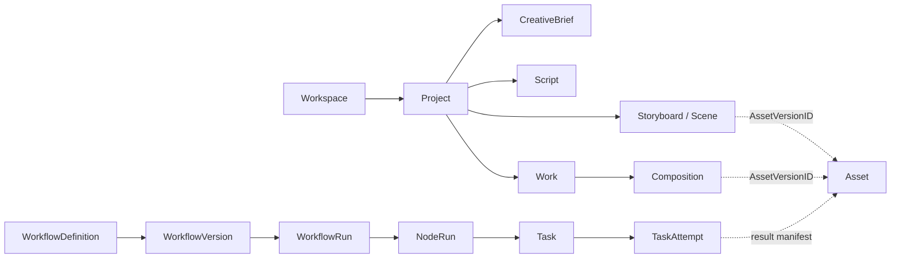

# MediaFlow 领域模型详细设计（DDD v1.0）

> 文档状态：设计基线（待实现验证）  
> 上游依据：`docs/PRD/V1.0.md`、`docs/SAD/V1.0.md`  
> 文档路径：`docs/DDD/V1.0.md`  
> 版本：1.0  
> 日期：2026-10-20  
> 适用范围：Go 控制面领域层、应用层及跨领域协作契约

## 1. 文档边界和设计决策

本文仅规定领域语言、限界上下文、聚合边界、实体和值对象、业务不变量、命令、领域事件、事务边界和跨模块协作；不重复 PRD 的功能说明，也不在此规定具体表结构、SQL、HTTP 路由、队列选型或 FFmpeg 参数。

**设计强约束：**（1）聚合内不变量在一次持久化提交中成立；（2）跨聚合使用 ID 引用，不跨聚合持有可变对象；（3）已发布定义和已提交资产版本不可变；（4）工作流定义、运行、调度、执行尝试分离；（5）事件可能重复、乱序，消费者必须具备幂等与版本校验；（6）领域事实与外部副作用通过应用层协调。

约定：`ID` 为不可变类型化标识；`Version` 为乐观并发版本；`Revision` 为业务修订版本。本文的状态名与事件名是业务契约候选，后续状态机详细设计须保持一致，除非通过 ADR 更改。

## 2. 通用领域语言（Ubiquitous Language）

| 术语 | 精确定义 | 非同义项 |
|---|---|---|
| Workspace | 资源归属、授权与配额边界 | Team（协作集合） |
| Project | 围绕创作目标的业务容器 | Work（交付作品） |
| CreativeBriefRevision | 一次确定的创作约束快照 | 可编辑的 Brief 草稿 |
| ScriptRevision | 一次确定的结构化剧本内容 | 执行任务输出的原始文本 |
| StoryboardRevision | 一次确定的有序场景集合 | SceneRevision（单场景修订） |
| Asset | 逻辑素材身份 | AssetVersion（不可变二进制及元数据） |
| CompositionVersion | 对确定媒体版本的时间轴编排快照 | RenderOutput（渲染产物） |
| WorkVersion | 作品的可审核、可交付版本 | WorkflowRun（执行记录） |
| WorkflowVersion | 发布后不可变的流程定义 | WorkflowRun（对该版本的一次运行） |
| NodeRun | 工作流运行中一个逻辑节点实例 | Task（可调度的工作单元） |
| TaskAttempt | 对 Task 的一次真实执行尝试 | Task（执行需求本身） |
| Lease | 带有效期的执行授权 | 任务已实际停止的证明 |
| Artifact | 执行器生成的待确认结果 | AssetVersion（业务正式管理的素材版本） |
| Domain Event | 领域内已发生的事实 | Command（要求执行的意图） |

**身份/版本约定：** `ProjectID`、`SceneID`、`TaskID` 等表示稳定身份；`*VersionID`、`*RevisionID` 表示确定内容；业务内容修订不能通过改写历史版本实现。

## 3. 限界上下文与聚合总览

| 上下文 | 聚合根 | 一致性边界与所有权 |
|---|---|---|
| Identity & Workspace | Workspace、Membership（可按组织规模调整） | 空间状态、成员授权关系 |
| Project | Project | 项目生命周期、所属空间、默认设置 |
| Creative | CreativeBrief、Script、Storyboard | 各自草稿、确认、修订发布；Scene 为 Storyboard 内实体 |
| Asset | Asset、AssetIngestion（上传会话） | 素材身份、版本提交、文件核验、生命周期 |
| Composition & Delivery | Composition、Work | 编排版本、作品审核、交付状态 |
| Workflow Definition | WorkflowDefinition | 草稿及已发布 WorkflowVersion |
| Workflow Execution | WorkflowRun；NodeRun 采用独立持久化一致性单元 | 运行级状态；节点级状态及依赖满足记录 |
| Task Execution | Task | 当前有效 Attempt、任务终态及结果提交 |
| Worker Management | Worker（包含 WorkerSession） | 会话身份、能力、存活状态 |
| Scheduling & Resource | ResourcePool、QuotaAccount / Reservation | 资源配额与预留；跨资源原子性在应用层处理 |
| Model Integration | ProviderConfiguration、ModelConfiguration | 凭证引用、能力配置版本 |
| Usage & Cost | Budget、UsageLedger | 预算约束、不可变用量记账 |

**关键规模选择：** `WorkflowRun` 与其成千上万个 `NodeRun` **不是**一个需要整体加载和整体更新的大聚合。`WorkflowRun` 管理顶层状态和版本，`NodeRun` 按节点独立并发更新；依赖满足记录具有唯一约束。`Task` 是独立聚合根，`TaskAttempt` 为其受控子实体或单独持久化记录，结果提交始终以 Task 聚合的授权条件为准。



## 4. Workspace 与 Project 聚合

### 4.1 Workspace

**实体：** `Workspace{ID, Name, OwnerID, Status, Version}`；`Membership{UserID, Role, Status}` 可独立建模以避免成员数增长造成聚合热点。**值对象：** `WorkspaceName`、`Role`、`Permission`、`WorkspaceStatus`。

**命令：** `CreateWorkspace`、`RenameWorkspace`、`InviteMember`、`ChangeMemberRole`、`SuspendWorkspace`。**不变量：** 空间拥有者明确；更改成员权限需要相应授权；空间停用阻止新业务执行，但不抹除审计记录；每个资源必须属于确定的 Workspace。

权限由身份/授权应用服务执行；业务聚合不应依赖 HTTP Token 对象。跨空间资产共享必须通过显式授权引用而不是修改原资产归属。

### 4.2 Project

**聚合根：** `Project{ID, WorkspaceID, Name, Status, Defaults, Version}`。**值对象：** `ProjectName`、`ProjectDefaults`、`ProjectStatus`。**命令：** `CreateProject`、`UpdateProjectDefaults`、`ArchiveProject`、`RequestProjectDeletion`。

**不变量：** `WorkspaceID` 创建后不可隐式变更；归档项目不应自动取消既有运行，运行策略由用例明确决定；删除必须先处理活跃工作流和资产引用；Project 只引用其他聚合 ID，不嵌入其全部内容。**事件：** `ProjectCreated`、`ProjectArchived`、`ProjectDeletionRequested`。

## 5. Creative 上下文

### 5.1 CreativeBrief 聚合

**实体：** `CreativeBrief{ID, ProjectID, CurrentDraft, Revisions, Version}`；修订为逻辑不可变快照。**值对象：** `Audience`、`LanguageTag`、`TargetDuration`、`AspectRatio`、`StyleConstraints`、`BudgetPreference`。

**命令：** `CreateBrief`、`EditBriefDraft`、`PublishBriefRevision`。**不变量：** 目标时长和比例有效；发布版本不可变；被 WorkflowRun 引用的输入必须为确定修订；修改草稿不会改变已有运行。**事件：** `BriefRevisionPublished`。

### 5.2 Script 聚合

**实体：** `Script{ID, ProjectID, Draft, Revisions, Version}`。**值对象：** `ScriptSection`、`NarrationText`、`EstimatedDuration`、`ContentHash`。**命令：** `GenerateScriptDraft`（由应用用例调起任务）、`EditScriptDraft`、`PublishScriptRevision`。

**不变量：** 发布时结构化内容符合 Schema；发布版本不可覆盖；版本关联来源 BriefRevisionID；AI 原始响应需要先验证再进入正式剧本版本。**事件：** `ScriptRevisionPublished`。

### 5.3 Storyboard 聚合

**聚合根：** `Storyboard{ID, ProjectID, DraftScenes, Revisions, Version}`。**内部实体：** `Scene{SceneID, Order, Narrative, VisualPrompt, AudioScript, AssetVersionRefs, LockState}`。**值对象：** `SceneDuration`、`SceneOrder`、`PromptSpec`、`TransitionSpec`、`SceneRevisionSnapshot`。

**命令：** `CreateStoryboardDraft`、`AddScene`、`ReorderScenes`、`EditScene`、`SelectSceneAsset`、`LockScene`、`PublishStoryboardRevision`。

**不变量：** 同一发布版本的场景顺序唯一且确定；SceneID 稳定且不因排序改变；引用的资产版本必须可用且经授权；已锁定 Scene 不能被自动生成静默覆盖；删除 Scene 不删除历史素材；发布生成新的不可变 StoryboardRevision。**事件：** `StoryboardRevisionPublished`、`SceneAssetSelected`。对于有大量场景的情况，可将场景草稿协作拆成独立编辑单元，但发布 StoryboardRevision 时仍要求得到一致的顺序快照。

## 6. Asset、Composition 与 Work

### 6.1 Asset 聚合

**聚合根：** `Asset{ID, WorkspaceID, ProjectID?, Type, CurrentVersionID?, Status, Version}`。**实体：** `AssetVersion{ID, VersionNo, StorageObjectRef, Checksum, MediaMetadata, Provenance, CommittedAt}`。**值对象：** `ObjectKey`、`ContentDigest`、`MimeType`、`MediaDimensions`、`MediaDuration`、`AssetProvenance`。

**命令：** `BeginAssetIngestion`、`ConfirmUploadedObject`、`CommitAssetVersion`、`SelectCurrentAssetVersion`、`ArchiveAsset`、`RequestAssetDeletion`。

**不变量：** 已提交 AssetVersion 的内容/校验值不可变；版本号在 Asset 内唯一；确认提交前文件必须可验证；不允许未经授权跨 Workspace 绑定素材；被受保护引用持有的版本不可被立即物理删除；任务重试只能新增候选版本或 Artifact，不能直接覆盖旧版本。**事件：** `AssetVersionCommitted`、`AssetDeletionRequested`、`AssetArchived`。

**重要边界：** 对象存储没有数据库事务，Asset 聚合只能保证元数据状态；`AssetIngestion` 应区分 `UPLOADING / UPLOADED / VERIFIED / COMMITTED / ABANDONED`，由应用层验证对象存在性并安排孤儿对象清理。

### 6.2 Composition 聚合

**聚合根：** `Composition{ID, WorkID, DraftTimeline, Versions, Version}`。**值对象：** `TimelineTrack`、`Clip`、`MediaRef(AssetVersionID)`、`TimeRange`、`CanvasSpec`、`RenderProfile`。

**命令：** `UpdateCompositionDraft`、`AttachClip`、`PublishCompositionVersion`。**不变量：** 片段时间合法，轨道引用明确，发布的 CompositionVersion 不可变；渲染输入必须指向确定的 AssetVersion。**事件：** `CompositionVersionPublished`。

### 6.3 Work 聚合

**聚合根：** `Work{ID, ProjectID, Versions, CurrentVersionID, Version}`。**内部实体/记录：** `WorkVersion{ID, CompositionVersionID, OutputAssetVersionID?, ReviewStatus, DeliveryStatus}`。**值对象：** `ReviewDecision`、`DeliveryStatus`、`OutputProfile`。

**命令：** `CreateWorkVersion`、`AttachRenderOutput`、`SubmitForReview`、`ApproveWorkVersion`、`RejectWorkVersion`、`DeliverWorkVersion`。

**不变量：** 未通过输出校验不可设为可交付；审核决定指向确定版本；渲染 Task 成功并不自动等于审核通过；交付不允许覆盖历史 WorkVersion；输出资产跨域存在性由应用服务核验。**事件：** `WorkVersionApproved`、`WorkVersionRejected`、`WorkVersionDelivered`。

## 7. Workflow Definition 聚合

**聚合根：** `WorkflowDefinition{ID, WorkspaceID, DraftGraph, PublishedVersions, Version}`；`NodeDefinition`、`EdgeDefinition` 是内部实体/值对象，`WorkflowVersion` 是发布后不可变快照。

**值对象：** `NodeType`、`PortSchema`、`ExecutionPolicy`、`RetryPolicy`、`TimeoutPolicy`、`ResourceRequirement`、`GraphHash`。

**命令：** `CreateWorkflow`、`AddNode`、`ConnectNodes`、`UpdateNodePolicy`、`ValidateWorkflowDraft`、`PublishWorkflowVersion`、`DeprecateWorkflowVersion`。

**发布不变量：** 节点 ID 唯一；不存在非法环；端口类型匹配；节点策略合法；每个必要输出可达；动态展开有上限；依赖的模型能力或处理器契约能够被解析；已发布 WorkflowVersion 不可修改。**事件：** `WorkflowVersionPublished`、`WorkflowVersionDeprecated`。

**规则：** WorkflowVersion 只定义生产方法，不包含用户某一次运行的实时状态。发布后变更必须创建新版本；旧运行继续绑定旧版本。

## 8. Workflow Execution 上下文

### 8.1 WorkflowRun 聚合

**字段：** `WorkflowRun{ID, WorkflowVersionID, WorkspaceID, ProjectID?, InputSnapshotRef, State, StartedAt, FinishedAt, Version}`。**值对象：** `RunTrigger`、`RunState`、`InputFingerprint`、`FailureSummary`。

**命令：** `CreateRun`、`StartRun`、`RequestPause`、`ResumeRun`、`RequestCancel`、`MarkRunSucceeded`、`MarkRunFailed`。

**不变量：** 每次运行绑定确定 WorkflowVersion 与输入快照；终态不可无条件重开；暂停、取消是意图与过程而非强制瞬间停止全部外部调用；成功需满足必要输出及所有必需节点终止条件；状态更新使用版本校验。**事件：** `WorkflowRunStarted`、`WorkflowRunPaused`、`WorkflowRunCancellationRequested`、`WorkflowRunSucceeded`、`WorkflowRunFailed`。

### 8.2 NodeRun 一致性单元

**字段：** `NodeRun{ID, WorkflowRunID, NodeDefinitionID, ExpansionKey?, State, InputSnapshotRef?, OutputRef?, RemainingDependencies, Version}`。

**值对象：** `DependencyKey`、`NodeOutcome`、`ExpansionIdentity`、`NodeState`。

**命令：** `ActivateNode`、`RecordDependencySatisfied`、`MarkNodeRunning`、`AcceptNodeOutput`、`SkipNode`、`BlockNode`、`WaitForApproval`。

**不变量：** 每条实际依赖满足关系只能计算一次；所有必要依赖满足前不得 READY；输出必须满足节点契约；NodeRun 的业务状态不能由 Worker 直接修改；同一动态展开键只对应一个确定 NodeRun。

### 8.3 依赖满足记录

为了处理重复事件，不直接使用无条件的 `remaining_dependencies--`。引入 `DependencySatisfaction{WorkflowRunID, TargetNodeRunID, DependencyKey, SourceOutcomeVersion}`，对 `(TargetNodeRunID, DependencyKey)` 设置逻辑唯一性；插入成功时才推进计数或重新计算满足条件。条件未选中的路径依据 Join 规则进入 SKIPPED，不将其误判为永远缺少依赖。

### 8.4 聚合间一致性

节点完成、后继节点激活和待分发 Task 创建涉及不同聚合。初期同 PostgreSQL 部署时，可由 **Workflow Progression Application Service** 在一个受控事务内协调 NodeRun 更新、依赖记录、Task 创建及 Outbox。该服务是跨聚合协调器，不意味着 NodeRun 与 Task 合并为一个领域聚合。

## 9. Task Execution 聚合

### 9.1 Task 聚合根

**字段：** `Task{ID, NodeRunID, WorkspaceID, Type, Capability, State, CurrentAttemptID?, AttemptCount, RetryPolicy, NextRunAt?, ResultRef?, Version}`。**内部实体：** `TaskAttempt{ID, Sequence, WorkerSessionID, LeaseEpoch, LeaseExpiresAt, State, ResultManifestRef?, Error?}`。

**值对象：** `TaskCapability`、`TaskPriority`、`LeaseEpoch`、`LeaseDeadline`、`RetrySchedule`、`TaskErrorCategory`、`ResultManifest`。

**命令：** `CreateTask`、`MakeReady`、`QueueTask`、`GrantExecutionLease`、`RenewLease`、`SubmitAttemptResult`、`RecordAttemptFailure`、`ScheduleRetry`、`CancelTask`。

**不变量：** 一个 Task 同时仅承认一个当前执行代数；LeaseEpoch 单调递增；每次 Attempt 编号唯一；只有当前有效 Attempt 和授权令牌能正式提交结果；Task 最终只接受一个有效结果；终态不可随意回退；自动重试不超过 RetryPolicy；已取消任务的迟到结果不得再次改变其业务终态。

### 9.2 推荐任务状态约束

| 当前状态 | 允许的关键后继 | 触发主体 |
|---|---|---|
| PENDING | READY / CANCELED | Workflow Progression |
| READY | QUEUED / CANCELED | Scheduling Application |
| QUEUED | RUNNING / READY / CANCELED | Scheduler / Recovery |
| RUNNING | SUCCEEDED / RETRY_WAIT / FAILED / CANCELED | Task Completion / Recovery |
| RETRY_WAIT | READY / FAILED / CANCELED | Retry Timer / Recovery |
| SUCCEEDED、FAILED、CANCELED | 无普通状态后继 | 终态 |

本表规定核心合法迁移范围；在下一份状态机规格中细化超时、任务提交竞争、恢复状态与错误分类。**不建议把 `TIMED_OUT` 必然设为 Task 终态**：执行尝试可以超时，而 Task 可以进入等待重试。

### 9.3 结果提交域规则

`AcceptTaskResult(TaskID, AttemptID, LeaseEpoch, ResultManifest)` 必须先检验当前 Task 版本、Attempt 归属、有效执行代数、取消标记及输出契约。验证成功后，以原子方式写入有效 ResultRef 和 Task 终态，并登记后续推进事件。仅有上传成功的临时 Artifact 不代表 Task 成功。

### 9.4 外部副作用边界

内部可以约束**结果只被有效确认一次**，但无法严格保证第三方 AI API 只执行或计费一次。外部任务优先使用供应商幂等键、JobID 查询与回执核对；能力缺失时，自动重试策略需明确重复成本风险。

## 10. Worker、资源、模型与用量领域

### 10.1 Worker

**聚合根：** `Worker{ID, CapabilitySet, Status, ActiveSession?}`。**实体：** `WorkerSession{ID, StartedAt, HeartbeatAt, Resources, DrainState}`。**值对象：** `Capability`、`WorkerResources`、`SessionStatus`。

**命令：** `RegisterWorker`、`StartSession`、`ReportHeartbeat`、`BeginDrain`、`ExpireSession`。**不变量：** 会话重启生成新 SessionID；旧会话不得续租新会话的任务；心跳仅表明会话最近可达，不证明任务外部副作用已停止。**事件：** `WorkerSessionStarted`、`WorkerSessionExpired`、`WorkerDrainRequested`。

### 10.2 ResourcePool 与 QuotaAccount

**聚合根：** `ResourcePool{ID, Capability, Capacity, Reservations, Version}`；`QuotaAccount{ID, WorkspaceID, Limit, Used, Reserved, Window, Version}`。**值对象：** `ResourceVector`、`QuotaWindow`、`ReservationToken`。

**命令：** `ReserveCapacity`、`ReleaseCapacity`、`ConsumeQuota`、`ExpireReservation`。**不变量：** 资源预留不超过已定义容量（允许明确声明超售策略时例外）；同一 ReservationToken 不得重复扣减；实际消耗与预留分开记录；跨资源池组合预留须由应用服务协调，不能假设跨数据库天然原子。

### 10.3 ProviderConfiguration 与 ModelConfiguration

**聚合根：** `ProviderConfiguration{ID, WorkspaceID, Endpoint, CredentialRef, Status, Version}` 与 `ModelConfiguration{ID, ProviderConfigurationID, CapabilitySet, ParameterSchema, Limits, Version}`。

**值对象：** `CapabilityDescriptor`、`ModelIdentifier`、`CredentialReference`、`RateLimitPolicy`。**不变量：** 密钥明文不进入领域事件；运行绑定模型配置快照；供应商特有参数通过能力 Schema 验证；降级切换需满足业务授权。**事件：** `ModelConfigurationPublished`、`ProviderConfigurationDisabled`。

### 10.4 UsageLedger 与 Budget

`UsageRecord` 为不可变的用量分录，包含 `SourceAttemptID`、供应商请求标识、计量类型、数量、估算/确认状态。`Budget` 管理预算上限和可执行策略。**不变量：** 同一供应商用量事件不重复入账；更正以冲正/补充记录表达；估算费用不得伪装为最终结算费用。**事件：** `UsageRecorded`、`BudgetThresholdReached`。

## 11. 领域事件契约

### 11.1 事件信封

所有持久化业务事件包含：`EventID`、`EventType`、`SchemaVersion`、`AggregateType`、`AggregateID`、`AggregateVersion`、`WorkspaceID`（适用时）、`OccurredAt`、`CorrelationID`、`CausationID`、`Payload`。事件不包含访问令牌、API Key 或未经授权的敏感原始内容。

### 11.2 核心事件目录

| 事件 | 产生者 | 主要消费者 | 业务结果 |
|---|---|---|---|
| BriefRevisionPublished | Creative | 工作流应用服务 | 可以基于确定创作输入发起生成 |
| ScriptRevisionPublished | Creative | Storyboard 用例、审计 | 提供稳定剧本来源 |
| StoryboardRevisionPublished | Creative | 工作流应用服务 | 按场景展开任务 |
| AssetVersionCommitted | Asset | Composition、Work、Workflow | 可引用的正式媒体版本 |
| WorkflowVersionPublished | Workflow Definition | 执行入口、模板目录 | 可用于新的 Run |
| WorkflowRunStarted | Workflow Execution | 执行初始化服务 | 激活起始节点 |
| TaskReady | Task Execution | Scheduler | 可争取执行资源 |
| TaskLeaseGranted | Task Execution | Worker 分发 | 某 Attempt 获得限时执行权 |
| TaskSucceeded | Task Execution | Workflow Progression、Usage | 推进节点；登记有效结果 |
| TaskFailed | Task Execution | Workflow Progression、告警 | 按节点失败策略处理 |
| WorkflowRunSucceeded | Workflow Execution | Work、通知 | 运行已产生合格输出 |
| WorkVersionDelivered | Composition & Delivery | 通知、统计 | 完成业务交付 |

### 11.3 事件发布语义

领域实体可产生事件，但**只有所在事务提交后**才允许发布。推荐在同一事务写入聚合变更与 Outbox。消费者按 EventID 去重，并按 AggregateVersion 或业务预期状态判断是否接受；不能假设全局消息严格有序。

**事件是事实而非命令。** 例如 `TaskSucceeded` 不意味着消费者无条件重放 `MarkNodeSucceeded`；消费者必须先校验当前 NodeRun 是否仍等待该 Task 的结果，以及该结果是否满足输出契约。

## 12. 跨模块命令与协作

| 业务用例 | 协调者 | 涉及聚合 | 同步检查 / 异步效果 |
|---|---|---|---|
| 创建项目 | ProjectApplication | Workspace、Project | 同步鉴权与项目创建 |
| 发布分镜 | CreativeApplication | Storyboard、Asset | 同步检查资产授权与版本；发布事件 |
| 启动工作流 | StartWorkflowApplication | WorkflowDefinition（只读）、WorkflowRun、NodeRun | 同步锁定版本、输入快照；Outbox 通知 |
| 节点依赖推进 | WorkflowProgressionApplication | NodeRun、Task | 事务推进；异步唤醒调度 |
| 领取任务 | SchedulingApplication | Task、ResourcePool、WorkerSession | 校验资源与租约，失败时不授予执行权 |
| 提交生成结果 | TaskCompletionApplication | Task、Asset、NodeRun（推进） | 先文件验证，事务确认结果，再触发推进 |
| 审核作品 | DeliveryApplication | Work、Asset（只读） | 版本/权限校验，更新审核结果 |
| 取消工作流 | WorkflowCancellationApplication | WorkflowRun、NodeRun、Task | 记录取消意图，再逐步传播/撤销授权 |

**禁止的越界调用：** Worker 直接写 Script/Storyboard/Work 表；Scheduler 修改 DAG 依赖；Provider Adapter 直接将 WorkflowRun 置为成功；前端通过上传 AssetVersionID 绕过授权；通过消息处理绕开 Task 结果提交聚合规则。

## 13. 三个关键事务与故障时序

### 13.1 启动 WorkflowRun

1. 应用层校验 Workspace、Project、WorkflowVersion 权限及预算策略。
2. 固定输入快照、版本和 Run 幂等键。
3. 在数据库事务中插入 WorkflowRun、初始 NodeRun 和 Outbox 事件。
4. 事务提交后发布事件；失败时由 Outbox 重试。
5. 初始化消费者幂等地激活起始节点。

**故障点：** 数据库已提交、响应丢失时，客户端使用相同幂等键重试应返回既有 Run。

### 13.2 并发 Claim Task

1. Scheduler 读取候选 READY/QUEUED Task 和可用 Worker 能力。
2. 在原子协调边界内核对配额、Task 版本和当前租约。
3. 创建 TaskAttempt，增加 LeaseEpoch，记录资源 Reservation。
4. 提交状态与 Outbox，再分发执行授权。
5. 若下发失败，允许 Lease 超时或显式回收后重新调度。

**关键条件：** 同一 Task 不得出现两个同时被控制面认可的有效 LeaseEpoch；Worker 本地执行可能仍重复，必须依赖后续 Fencing Token 防止结果覆盖。

### 13.3 提交结果并推进 DAG

1. Worker 上传 Artifact 并提交清单（含哈希、输出类型、AttemptID、LeaseEpoch）。
2. 应用服务验证租约、Task 状态和清单契约，并核实文件可用性。
3. 在受控事务中确认有效结果引用、Task SUCCEEDED、结果资产元数据和 Outbox 事件。
4. Workflow Progression 幂等消费 TaskSucceeded，完成 NodeRun 并满足后继依赖。
5. 清理孤儿 Artifact、释放资源 Reservation；失败可重试和对账。

**注意：** 对象存储与数据库无法原子提交。正式资产只引用已经验证且具有可持续保存策略的对象，孤儿对象由独立清理程序处理。

## 14. 领域仓储与 Go 接口建议

仓储按聚合根设计，接口定义在拥有业务语义的模块中；应用服务负责开启事务和调用仓储，不应让领域对象直接访问数据库。

```go
// 示意契约：类型定义和 TxManager 在具体工程中细化。
type TaskRepository interface {
    Get(ctx context.Context, id TaskID) (*Task, error)
    Save(ctx context.Context, task *Task, expectedVersion uint64) error
}

type WorkflowRunRepository interface {
    Get(ctx context.Context, id WorkflowRunID) (*WorkflowRun, error)
    Save(ctx context.Context, run *WorkflowRun, expectedVersion uint64) error
}

type UnitOfWork interface {
    WithinTx(ctx context.Context, fn func(ctx context.Context) error) error
}
```

**原则：** `Save` 的乐观锁失败必须显式返回冲突错误；跨模块的同库事务只能通过受控 UnitOfWork 协调，不应建立任意 Repository 相互依赖。任务高并发 Claim 等操作允许在应用/基础设施层使用专门原子命令接口，不强制先装载大聚合再保存。

## 15. 值对象规范

值对象采用不可变语义，构造时进行验证，比较基于值而非 ID。

| 值对象 | 典型校验 |
|---|---|
| `WorkspaceID`、`TaskID` | 非空、格式合法、不可混用 |
| `TargetDuration` | 正数，符合业务上限 |
| `AspectRatio` | 分子分母正数，规范化后比较 |
| `TimeRange` | 开始 ≥ 0，结束大于开始 |
| `ContentDigest` | 算法标识、格式和长度合法 |
| `StorageObjectRef` | 指向受管理的 bucket/key；禁止路径穿越 |
| `RetryPolicy` | 最大次数、延迟和总时间窗受限 |
| `ResourceVector` | 各资源维度非负，单位明确 |
| `LeaseEpoch` | 单调递增；不能回退复用 |
| `Money` / `UsageQuantity` | 币种、精度和计量单位明确 |
| `ModelCapability` | 能力名、输入输出 Schema、版本明确 |

不得将以 `float64` 表示的金额作为精确计费的权威数据；外部计量需有单位和精度。

## 16. 领域规则的验证场景

| ID | 测试 | 预期 |
|---|---|---|
| DDD-01 | 修改已发布 WorkflowVersion | 拒绝；要求产生新版本 |
| DDD-02 | 已运行工作流期间修改 Brief | 原 Run 的输入快照不变 |
| DDD-03 | 发布含重复 Scene 顺序的分镜 | 拒绝 |
| DDD-04 | TaskSucceeded 事件被消费两次 | 后继依赖只满足一次 |
| DDD-05 | 两个 Scheduler 同时 Claim 同一 Task | 最多一个有效执行代数成功 |
| DDD-06 | 旧 Attempt 在新 Lease 发放后提交结果 | 旧提交被拒绝 |
| DDD-07 | 上传成功但结果登记事务失败 | 不形成已完成 Task；对象可对账清理 |
| DDD-08 | 已被交付作品引用的 AssetVersion 被删除 | 拒绝直接物理删除或进入受控保留流程 |
| DDD-09 | AI Provider 超时后重试 | TaskAttempt 可增加，原 TaskID 不变 |
| DDD-10 | 工作流在人工审批节点等待 | WorkflowRun 不误判为失败 |
| DDD-11 | 作品渲染成功但未审核 | WorkVersion 不可误标为已交付 |
| DDD-12 | 非授权 Workspace 绑定 AssetVersion | 拒绝 |
| DDD-13 | 重复用量事件到达 | 不重复入账 |
| DDD-14 | 用户对 Scene 3 局部重生成 | 旧版本保留，受影响节点重跑，不覆盖无关结果 |

## 17. 设计取舍与待决问题

| 编号 | 待决事项 | 当前建议 | 触发重新评审的条件 |
|---|---|---|---|
| O-01 | Scene 是否独立聚合 | 先作为 Storyboard 内实体 | 大型分镜、实时多人协作、高写入冲突 |
| O-02 | NodeRun 与 WorkflowRun 的边界 | 分离更新，应用层协调 | 强一致复杂度超过现有边界收益 |
| O-03 | TaskAttempt 是否单独 Repository | Task 授权规则拥有，独立表持久化 | 尝试数据规模及查询需求增长 |
| O-04 | 跨上下文事件一致性 | 同库事务 + Outbox + 幂等消费者 | 部署拆分或跨存储事务边界变化 |
| O-05 | 局部重运行身份 | 新 Run / Revision Run 引用旧结果 | 交互验证产生更细粒度的版本分叉需求 |
| O-06 | 动态展开一致性 | ExpansionKey 唯一且结果持久化 | 需要无限流处理或长期增量图 |
| O-07 | 预算强约束 | 预算预留 + 最终用量冲正 | 第三方计费延迟与并发超支风险提升 |

待决项不是实现漏洞，必须在对应详细设计进入编码前由 ADR 明确决策。

## 18. 与后续文档和代码的交接

| 下游工件 | 直接继承本文件的内容 |
|---|---|
| `docs/Database/V1.0.md` | 聚合存储映射、版本列、唯一约束、跨聚合事务、Outbox |
| `docs/Workflow/V1.0.md` | WorkflowRun / NodeRun 迁移矩阵、依赖推进、动态展开 |
| `docs/Scheduler/V1.0.md` | Task Claim、LeaseEpoch、资源预留与公平调度 |
| `docs/Worker/V1.0.md` | Session、执行授权、心跳、结果清单和取消语义 |
| `docs/API/openapi.yaml` | 应用命令、业务标识、错误语义、幂等键 |
| `backend/internal/*` | 聚合、值对象、领域事件、仓储接口、应用用例 |
| `docs/Testing/V1.0.md` | 本文件的 DDD-01 至 DDD-14 不变量用例 |

**优先实现的最小领域闭环：** `Project → WorkflowVersion → WorkflowRun → NodeRun → Task → TaskAttempt → AssetVersion → NodeRunSucceeded → WorkflowRunSucceeded`。先采用确定性 Mock Handler 验证一致性，再接入真实 Model Gateway 和媒体处理器。不得用 Mock 成功替代任务故障恢复和跨存储一致性测试。

## 19. DDD 设计完成判据

- 每个核心业务对象有唯一的上下文拥有者。
- 聚合根和跨聚合 ID 引用明确。
- 所有已发布版本、有效执行结果和资产版本具有不可变语义。
- Task 与 Attempt、WorkflowRun 与 NodeRun 的职责不混淆。
- 关键不变量可映射为数据库约束或领域测试。
- 跨模块协作有明确应用协调者、事务边界与事件语义。
- 失败、重复、乱序和迟到结果有预定处理规则。
- 待决问题列入后续详细设计，不以隐含假设进入生产代码。

---

**结论：** MediaFlow 的领域核心不是“视频生成任务表”，而是可版本化的创作资产、确定性工作流运行、具备受控授权的任务执行，以及可追踪的作品交付。此 DDD 基线用于约束后续数据库、状态机与 Go 代码设计，具体持久化和协议细节由对应专题文档继续完成。
