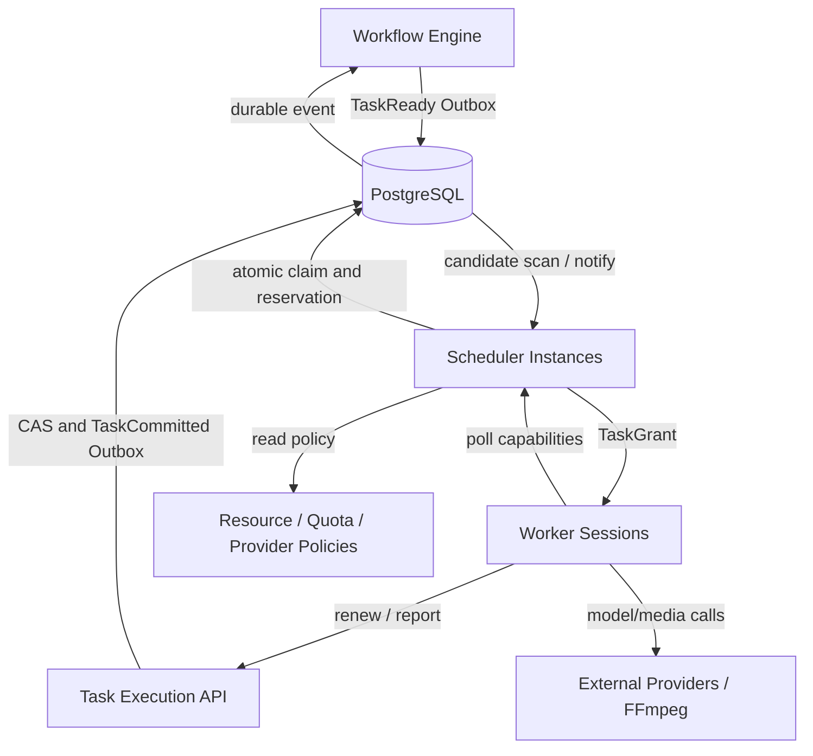

# MediaFlow 分布式任务调度器详细设计（Scheduler v1.0）

| 属性 | 内容 |
|---|---|
| 文档版本 | 1.0 |
| 日期 | 2026-10-20 |
| 状态 | 详细设计基线；DDL、性能目标尚须实施验证 |
| 上游文档 | `docs/PRD/V1.0.md`、`docs/SAD/V1.0.md`、`docs/DDD/V1.0.md`、`docs/Database/V1.0.md`、`docs/Workflow/V1.0.md` |
| 代码目标 | `backend/internal/scheduler`，与 `task`、`worker`、`workflow`、`model` 等模块协作 |

## 0. 范围、术语与约束等级

本文专门说明 **READY Task 如何获得执行机会、资源如何预留、执行权如何授予和撤销、多个调度器如何并发工作**。不重新定义产品功能、DAG 的 Join 语义，也不替代下一份 Worker Runtime 协议设计。

本文用 **MUST** 表示正确性必要约束；**SHOULD** 表示推荐默认实现，可通过 ADR 变更；**MAY** 表示可选增强。示例阈值和容量均为配置演示而非已经验证的生产指标。

### 0.1 外部契约

- Workflow Engine 对 NodeRun 进行依赖判断，生成 `Task(status=READY)`；Scheduler 不自行判断 DAG 是否完成。
- PostgreSQL 中的 `tasks`、`task_attempts`、资源账户和预留记录是执行权的权威来源；Redis Stream 等仅用于唤醒/通知。
- Worker 必须从受控调度/领取接口获得 `TaskAttempt + lease_epoch + lease_token`；不可自行从通知消息获得合法执行权。
- 模型适配层提供 Provider/Model 的能力、限额和错误分类；Scheduler 不执行模型 HTTP 请求。
- 结果提交与 TaskCommit 由 Task Execution 完成；随后由 WorkflowProgression 通过 Outbox 可靠推进节点。Scheduler 不将 NodeRun 设置为 SUCCEEDED。

### 0.2 先冻结的关键决策

1. **采用 Pull/Offer + 原子 Claim**：Worker 携带能力和 Session 请求任务；Scheduler 在权威事务内分配 Attempt。允许未来改成中心化派发，但执行授权语义不变。
2. **READY 为权威待调度状态；QUEUED 为可选传递阶段**：QUEUED 不能单独证明任务已经分配。执行权仅由 RUNNING Task、当前 Attempt、合法 Lease 和资源预留联合确认。
3. **不依赖恰好一次消息处理**：重复唤醒无害，所有状态切换需条件化且幂等。
4. **租约期满意味着旧 Attempt 失去提交资格，不意味着远端 AI 计算必然停止**。
5. **任务费用和资源配额分账**：本地资源并发槽、Provider 速率桶、Workspace 预算不是同一资源。
6. **严格的锁序以数据库真实写入序列为准**：任务领取、续租、超时回收、结果提交分别定义锁路径；跨域反向锁禁止。

---

## 1. 职责划分与交互架构



| 子系统 | 拥有的数据或决策 | 不允许做的事 |
|---|---|---|
| Workflow Engine | NodeRun、依赖决议、TaskReady 意图 | 不直接分配 Worker 或修改资源账户 |
| Scheduler | 任务筛选、准入判断、资源预留、Claim 决策 | 不推进 DAG；不决定媒体结果是否有效 |
| Task Execution | Task/Attempt 状态、Lease、结果提交协议 | 不绕过工作流状态生成后继任务 |
| Worker Manager | Worker/Session 身份、心跳、能力和健康 | 不凭心跳直接将 Task 标记成功 |
| Model Gateway / Quota | Provider 参数、速率策略、供应商状态 | 不直接修改工作流实例 |
| Reconciler | 异常检测和条件化恢复 | 不无条件重置已经成功的 Task |

Scheduler 作为应用服务，调用 Task Execution 提供的 Claim 领域端口；事务的**唯一拥有者**是 Claim 服务，禁止 Scheduler 与 Worker Manager 双方各自执行半套预留操作。

## 2. 调度数据模型

### 2.1 TaskCandidate（读模型）

从权威数据构建，只用于候选排序：

`task_id`, `workspace_id`, `workflow_run_id`, `task_type`, `capability`, `priority`, `created_at`, `next_run_at`, `resource_requirements`, `provider_id`, `model_configuration_id`, `retry_policy`, `deadline_at`, `lock_version`。

`priority` 为有界整数，允许负数；`deadline_at` 可选，仅影响调度排序，不承诺必定按期完成。

### 2.2 WorkerCapability / ResourcePool

WorkerSession 上报当前能力与动态可用度；资源池作为持久化调度容量边界。建议区分：

- `ResourcePool`: `id`, `kind`, `capability`, `capacity`, `reserved`, `status`, `lock_version`。
- `WorkerSession`: `id`, `worker_id`, `capability_set`, `heartbeat_at`, `status`, `max_slots`, `available_snapshot`。
- `ResourceReservation`: `id`, `task_id`, `attempt_id`, `pool_id`, `worker_session_id`, `resource_vector`, `state`, `reservation_token`, `expires_at`。

**不要把 Worker 心跳中报告的空闲 CPU 当成已可提交的预留余额**。同一 Worker 的排他容量需由数据库行或等价原子协调记录控制；快照主要用于候选筛选和监控。

### 2.3 Quota / RateLimit / Budget

分别定义：

- `ConcurrencyQuota`: 正在预留/执行的槽位上限；分 Workspace、任务类别、Provider 维度。
- `RateLimitBucket`: 在时间窗口或令牌桶内允许启动的外部请求量。RPM、TPM 必须分别计量；不能只用 concurrency 模拟 TPM。
- `BudgetAccount`: 预算授权和已使用费用；估算成本与真实成本分开入账。

所有多维限额必须在一次可解释的 AdmissionDecision 中决议；所有权属于指定限额协调组件。配置变更需要保留版本或生效时间，防止历史执行无法解释。

### 2.4 建议的 DDL 增量（针对 Database v1.0，**草案，尚未执行迁移**）

```sql
-- 对既有 tasks 扩展字段；上线前需编写幂等迁移并核查历史数据。
ALTER TABLE tasks ADD COLUMN IF NOT EXISTS logical_task_key text;
ALTER TABLE tasks ADD COLUMN IF NOT EXISTS deadline_at timestamptz;
ALTER TABLE tasks ADD COLUMN IF NOT EXISTS scheduling_class text NOT NULL DEFAULT 'default';
CREATE UNIQUE INDEX IF NOT EXISTS ux_task_logical_key
  ON tasks(node_run_id, logical_task_key)
  WHERE logical_task_key IS NOT NULL;

-- 表结构是 Scheduler 独立建议，需与 Database v1.0 的资源表详细设计合并。
CREATE TABLE IF NOT EXISTS resource_pool_counters (
  pool_id uuid PRIMARY KEY,
  capacity_slots integer NOT NULL CHECK (capacity_slots >= 0),
  reserved_slots integer NOT NULL DEFAULT 0 CHECK (reserved_slots >= 0),
  lock_version bigint NOT NULL DEFAULT 0,
  CHECK (reserved_slots <= capacity_slots)
);

CREATE TABLE IF NOT EXISTS scheduler_reservations (
  id uuid PRIMARY KEY,
  task_id uuid NOT NULL REFERENCES tasks(id),
  attempt_id uuid NOT NULL REFERENCES task_attempts(id),
  worker_session_id uuid NOT NULL REFERENCES worker_sessions(id),
  pool_id uuid NOT NULL REFERENCES resource_pool_counters(pool_id),
  slots integer NOT NULL CHECK (slots > 0),
  status text NOT NULL CHECK (status IN ('ACTIVE','RELEASED')),
  created_at timestamptz NOT NULL DEFAULT now(),
  released_at timestamptz,
  UNIQUE(attempt_id, pool_id)
);
CREATE INDEX IF NOT EXISTS ix_scheduler_reservations_active_pool
  ON scheduler_reservations(pool_id) WHERE status = 'ACTIVE';
```

**重要：** 上面 `scheduler_reservations` 是独立示例名，不建议与既有 `resource_reservations` 长期共存。实施应以 `resource_reservations` 为最终表名合并字段；`resource_pool_counters` 可在资源池表中内嵌，取决于迁移演进。`tasks.logical_task_key` 是 Workflow v1.0 已识别的必需补充。

**更强多租户约束**：实际迁移应补充复合 FK，使预留、Task、Attempt、WorkerSession 的归属和当前执行一致；跨租户权限在应用层和可行的 DB 约束中同时执行。上述 DDL 不可直接视为完整生产迁移。

---

## 3. 调度生命周期与状态语义

### 3.1 主流程

```text
WorkflowProgression: NodeRun READY → Create Task READY + Outbox
        │
Scheduler discovery: READY and due, workflow RUNNING
        │
Admission: authorization → policy → rate → quota → resource
        │
Atomic Claim: reserve + insert Attempt + bump lease_epoch
        │
Task RUNNING / Attempt RUNNING / ResourceReservation ACTIVE
        │
Worker executes; renews lease and reports progress
        ├── success → TaskCommit → release reservation → WorkflowProgression
        ├── retryable fail → Attempt FAILED; Task RETRY_WAIT; release
        ├── final fail → Attempt FAILED; Task FAILED; release
        ├── cancellation → revoke lease + Task CANCELED; release
        └── expiry → Attempt TIMED_OUT/ABANDONED; Task RETRY_WAIT/FAILED; release
```

### 3.2 READY 与 QUEUED

采用 `READY` 直接参与 Claim 为默认实现。`QUEUED` 可以表示进入外部分发环节，但**不能**表示已拿到资源预留或已有 Attempt；对遗留 `QUEUED` 必须提供转回 READY 的恢复规则。禁止 Worker 只凭 QUEUED 的队列消息开始执行。

### 3.3 任务准入谓词

`CanClaim(task, session, now)` 必须全部满足：

1. Task `status=READY`，若重试到期必须先在独立事务转 READY。
2. `next_run_at IS NULL OR next_run_at <= database_now`。
3. 对应 WorkflowRun 处于允许新执行的 RUNNING；非 CANCELING、PAUSED 或终态。
4. WorkerSession 为 ACTIVE，心跳未超过阈值，Worker 非 DRAINING/DISABLED。
5. Capability、执行环境和资源需求匹配。
6. Workspace、Provider、资源池并发配额允许。
7. 速率额度和预算授权允许（是否硬性预算需要明确产品策略）。
8. Task 未有当前有效执行权，未被其他事务成功 Claim。

状态与时间条件必须在 Claim 事务内**再次验证**；只在读取候选时校验不足以保证正确性。

---

## 4. Candidate Discovery 与公平调度

### 4.1 发现机制

- `Outbox(TaskReady)` 触发快速扫描，投递可丢、重复、乱序。
- Scheduler 周期性从 PostgreSQL 扫描 `READY` 且到期的 Task，保障漏通知恢复。
- 候选查询必须分页/限批，不允许扫描所有历史 Task 到内存。
- `RETRY_WAIT` 到期变为 READY 由 RetryPromoter 控制并写 Outbox；不得由多个组件无约束切换。

候选排序推荐 `(effective_priority DESC, created_at ASC, id ASC)`，但数据库静态排序只是候选发现，不代表全局公平性已经实现。

### 4.2 公平性策略

推荐先采用 **workspace 轮转 + 每 workspace 内优先级排序**。长期可使用 Deficit Round Robin / Weighted Fair Queuing。

默认：

1. 将 READY Task 按 Workspace 分桶。
2. 在当前有容量的 Workspace 间轮转。
3. 每个 Workspace 优先选择较高优先级、等待较久的任务。
4. 每次分配扣除对应资源消耗权重或公平配额。
5. 无资源匹配的候选短暂跳过，但保留排队年龄。

跨 Scheduler 多实例如果需要**全局精确公平**，必须采用共享原子公平游标/额度或单一逻辑调度领导者；多个独立实例各自随机轮转只能提供近似公平，不可承诺严格保证。建议初期提供**可观测的近似公平**，系统吞吐升高后再评估独立公平控制器。

### 4.3 优先级与饥饿保护

- 优先级整数属于调度偏好，非执行保证。
- 可以按等待时间计算 `effective_priority`，但不得无限增长引起整数溢出。
- 记录 `queue_wait_seconds`、最长等待任务、各 Workspace 等待分位数。
- 因 Provider 不可用而阻塞的任务，优先级再高也不可强占其他资源。

---

## 5. 资源匹配与资源预留

### 5.1 多资源向量

```json
{
  "capability": "media.ffmpeg.encode",
  "cpu_millicores": 2000,
  "memory_bytes": 2147483648,
  "concurrency_slots": 1,
  "gpu_count": 0,
  "gpu_memory_bytes": 0
}
```

资源类型必须具有固定单位、取值上下限和不可缺省含义。不得未经定义将 CPU、显存与 API 速率换算成一个总分。

### 5.2 匹配策略

1. 过滤不具备 Task Capability 的 Worker。
2. 过滤非 ACTIVE 或即将退出的 Session。
3. 过滤剩余容量不足的 Pool/Session。
4. 按资源碎片化、数据本地性和公平策略挑选最佳候选。
5. 在数据库事务内尝试预留；冲突时放弃该候选、退避重试。

**本地 CPU/内存使用率为观测指标，不是硬隔离。** FFmpeg 任务应由进程/容器/cgroup 等机制约束实际消耗。

### 5.3 并发预留与释放

Slot 预留的线性化点为：在锁住 Counter 后，以原子 UPDATE 检查 `reserved + requested <= capacity`，并在**同一个事务**写入唯一 Reservation 和 Attempt。若事务回滚，所有变化一并回滚。

```sql
UPDATE resource_pool_counters
SET reserved_slots = reserved_slots + $2, lock_version = lock_version + 1
WHERE pool_id = $1
  AND reserved_slots + $2 <= capacity_slots
RETURNING reserved_slots;
```

零行返回表示无额度或资源池不存在，**不允许继续授予租约**。并发 Worker 容量还需要独立的 WorkerSession Counter 或 pool 按 Worker 粒度建模；不得只限制集群总额后超配单机。

释放时只对 `ACTIVE → RELEASED` 的唯一预留进行一次计数扣减。要求 `UPDATE ... RETURNING` 的实际行数确定是否扣减，重复释放为 no-op。资源账户和 Reservation 应在同一事务中变更。

### 5.4 多池同时预留

一条任务可能需要 Worker CPU Pool + Workspace 并发 Pool + Provider 并发 Pool。

全部所需池按照**稳定 pool_id 顺序**锁定/预留；任何一个失败都整体回滚。避免任务先占一个稀缺资源然后无限等待其他资源。不可将多个独立进程的本地锁当成跨实例保证。

---

## 6. Provider 限流与成本准入

### 6.1 三类不同控制

| 控制类型 | 例子 | 何时消耗/归还 |
|---|---|---|
| 并发槽 | 某 Provider 最多同时 8 个生效请求 | Claim 预留，终止后释放 |
| 请求速率 | 例如每分钟允许 N 次启动（RPM） | **外部请求发起前**消耗；通常不因失败回退 |
| Token 速率 | 例如 TPM 配额 | 发起前按估算预留，结束后按实际结算；未知用量采用保守策略 |

### 6.2 权威限额实现

对于准确的跨实例速率控制，应提供单点逻辑限额协调器或持久化原子桶。Redis Lua 可以作为高速协调实现，但重启/故障、失效和数据库之间的原子性必须有明确策略；不能声称 Redis 限流与 PostgreSQL Claim 形成一个天然原子事务。

**推荐基线：** Task Claim 只预留任务执行并发额度，实际 Provider 速率额度由 Worker 调用前经统一 RateLimit Service 原子获取，未获额度则进入等待/延迟，不持有不必要的稀缺 Worker 槽太久。若需要等待远大于正常执行时间，Worker 应主动释放或返回 `RATE_LIMIT_WAIT`，通过 TaskExecution 安全转入 RETRY_WAIT。Provider 的真实请求开始时刻记账，而非仅 Task 领取时刻。

### 6.3 429 与 Retry-After

Provider 返回 429 时：

- 识别供应商提供的合法 `Retry-After` 或官方建议等待时间。
- 更新 Provider 层临时抑制窗口；合理应用指数退避与 jitter。
- 按 RetryPolicy 对任务安排重试；不可无限重试。
- 记录 Provider、Model、错误码及是否已经真实发出调用。
- 不因同一 Provider 的限流停止其他独立 Provider 和 FFmpeg 任务。

### 6.4 费用预算

- **准入预算预估**与**实际 UsageLedger 记账**必须分离。
- 预算硬限制应在 Claim/外部调用前做原子授权或预留；预估差额由完成后结算和下一次准入收敛。
- 实际供应商异步计费可能延迟，无法保证一分钱不超预算。界面和契约需披露估计与实际差异。
- 需要区分因重试产生的新增费用和结果确认中的幂等重复。

---

## 7. Claim 事务与执行授权（核心）

### 7.1 事务前流程

Worker 携带 `worker_session_id`、支持能力和最大可接受任务数发起 Poll。服务端只信任已登记 Session 的能力和权限，对请求中的能力声明做交集限制。

Scheduler 计算一批候选和预选资源池，然后调用 **TaskClaimService**。候选信息仅供优化，事务内必须重新读取校验。

### 7.2 TX-SCH-01：Claim 原子提交

```text
BEGIN (READ COMMITTED)
  1. 依据稳定顺序锁定必须保护的 WorkflowRun gate（若设计要求）
  2. 锁定 Task 行，要求 status=READY、时间到期、Run 允许调度
  3. 校验 WorkerSession ACTIVE、能力匹配、预算和策略版本
  4. 锁定所需 ResourcePool / QuotaAccount（稳定 ID 顺序）
  5. 原子预留所有必要资源；任一失败则 ROLLBACK
  6. 使 Task.lease_epoch += 1；Task.attempt_count += 1
  7. INSERT TaskAttempt(status=RUNNING, attempt_no, lease_epoch, token_hash, expiry)
  8. UPDATE Task SET current_attempt_id=新 Attempt, status=RUNNING, lock_version+=1
  9. INSERT 唯一 ResourceReservation(s)
 10. INSERT Outbox(TaskLeaseGranted) 与审计元数据
COMMIT
→ 返回 TaskGrant（包含明文短期 token，DB 只存散列）
```

**锁序协调**：Database v1.0 原始“Task→Attempt→Pool”锁序与 Workflow v1.0 的 Run Gate 存在潜在交叉。实施版本须采用统一矩阵：

- 所有**涉及新授权/取消门禁**的事务先读/锁 `workflow_runs`，再锁 `tasks`，再锁 `task_attempts` 和按 pool_id 排序的资源池。
- 单纯结果提交可先锁 Task，但**不得在已持 Task 锁后反向锁 WorkflowRun**。可读取 Run 已持久化的取消代数快照并校验，或统一改为先锁 Run 后锁 Task（推荐后一种，更易解释）。
- 所有会同时触及这些对象的路径必须采用同一锁序，包括取消、租约回收、资源释放和结果提交。
- 多任务事务按 TaskID 升序，多个资源池按 PoolID 升序。禁止 Claim 事务持锁期间调用 AI API 或对象存储。

建议**最终统一默认锁序**为：`WorkflowRun（必要时） → Task（按 id） → Attempt → Resource/Quota（按 id）`；NodeRun/DAG Progression 使用独立事务，不在已持 Task/Resource 锁后反向获得 NodeRun 锁。对暂时不需要 Run 保护的路径，应核查是否会与取得 Run 锁的路径形成反向依赖。

### 7.3 如何保证取消与 Claim 互斥

仅在非锁定 SELECT 中看到 WorkflowRun=RUNNING 不足以防止取消竞态。

**推荐策略**：Claim 与 Cancel 都对对应 WorkflowRun 加行锁，并在锁内检查/更新取消门禁；Cancel 在此线性化点之后，后续 Claim 必须失败。已经获租约的 Task 由取消处理流程撤销，迟到提交不得覆盖取消结果。

对于高并发单 Run，可演进为独立的 RunAdmissionGate 行，从而减少 Run 聚合行热点，但需要独立设计原子更新和一致性。

### 7.4 租约时间

- 由服务端数据库时钟决定 `lease_expires_at`。
- `lease_duration`、`renew_interval`、`heartbeat_grace` 使用配置，且保证续租周期显著小于租约周期。
- 示例：Lease=60s、续租=15s、心跳=10s；仅用于演示，必须依据最长网络波动和负载测试校准。
- 应用时统一比较同一 DB 时间语义，避免多个 Scheduler 主机时钟偏差。

### 7.5 授权响应丢失

Commit 成功但 Worker 未收到 Grant 时，Task 仍 RUNNING，随后租约到期恢复。Worker 重试 Poll 不应为同一 Task 无条件创造第二个 Attempt。

如果需要优化，可提供通过幂等请求 ID 查询已授予但未确认的 Grant；但明文 lease token 不应长期持久化。最简单的正确方案是等待租约到期并重新分配，避免不安全的重复授权。

---

## 8. Lease 续租、完成与回收

### 8.1 TX-SCH-02：续租

Worker 提交 `attempt_id + lease_epoch + token + session_id`。

- 服务端锁定/条件更新 Task 和 Attempt。
- 验证 Task 当前指针、运行状态、租约未过期、WorkerSession 有效、Run 未取消。
- 使用数据库时间延长 `lease_expires_at`；只允许适度向前延长，不接受客户端任意未来时间。
- 同步延长需同租约生命周期的资源预留有效期。

失去执行权返回 `LEASE_LOST`，Worker 应尽快终止可停止的操作并丢弃未提交结果。

### 8.2 TX-SCH-03：成功完成

TaskExecution 在一个事务中：校验当前租约、提交结果引用、设置 Attempt/Task SUCCEEDED、释放所有 ACTIVE ResourceReservation、记 Outbox。**不得在持锁事务内上传大型文件。** WorkflowProgression 在独立事务推进 NodeRun。重复 ResultCommit 返回已经确认的结果（若内容一致），冲突结果拒绝。

### 8.3 TX-SCH-04：失败报告

Worker 对结构化错误作报告。

- 可重试：Attempt FAILED，Task RETRY_WAIT，并设置下一次执行时间。
- 不可重试或耗尽策略：Attempt FAILED，Task FAILED。
- 释放资源预留并写 Outbox。
- 仅当 Task 最终失败时，Workflow Engine 才作节点失败传播。

### 8.4 TX-SCH-05：租约回收

Reconciler 扫描 `RUNNING` Attempt 且 `lease_expires_at < clock_timestamp()`。

锁定 Run Gate（如果涉及取消一致性）、Task、Attempt 及资源池；再次验证是否仍是当前 Attempt、Epoch 未变化且确实过期。若是：将 Attempt 标记 TIMED_OUT 或 ABANDONED，Task 按策略进 RETRY_WAIT/FAILED，释放 ACTIVE 资源预留，写 Outbox。

若旧 Attempt 早已不是当前执行权，则仅做幂等清理，绝不回写新 Task 状态。

### 8.5 租约与 WorkerSession 心跳

Session 失联只能作为恢复的线索，**不能单独证明 Task Lease 已失效**。按照租约期限或经授权撤销逻辑决定何时回收。Worker DRAINING 不领取新任务，但现有 Task 可按策略继续、转移或取消。

---

## 9. 错误分类、重试与延迟队列

| 条件 | Task 行为 | 配额/资源行为 |
|---|---|---|
| 暂无可匹配 Worker | 保持 READY | 不产生 Attempt/预留 |
| 资源池不足 | 保持 READY | 不预留或事务回滚 |
| Workspace 并发满 | 保持 READY | 无新预留 |
| Provider RateLimit 未允许发出调用 | 可短等待或安全回到 RETRY_WAIT | 释放不需要的 Worker 槽 |
| API 429 | RETRY_WAIT 或 FAILED（超限） | 尽快释放并发槽，保留速率实际消耗记录 |
| API 可重试服务错误 | RETRY_WAIT | 释放资源预留 |
| 不可重试参数错误 | FAILED | 释放资源预留 |
| Worker 超时 | RETRY_WAIT/FAILED | 租约失效、释放预留 |
| 取消 | CANCELED（满足撤销语义后） | 释放预留；远端可能仍计费 |

重试采用有上限的尝试次数/时间窗；指数退避 + jitter，并遵守 Provider 明确的合法 Retry-After。反复资源缺额不应消耗 Task 的业务重试次数（因为根本没有开始 Attempt）。

---

## 10. 分布式 Scheduler 一致性与领导者策略

### 10.1 多实例并发

所有 Scheduler 实例是可替换无状态进程；多个实例可同时搜索候选任务。唯一有效 Claim 由 PostgreSQL 行锁/条件更新、唯一 Attempt 约束、资源账户原子更新共同保证。

`SELECT ... FOR UPDATE SKIP LOCKED` 适用于减少队列式行竞争，但不是公平调度或总配额正确性的完整方案。不能先在一个事务里释放锁，再在后续事务中假设任务仍然由该实例独占。

### 10.2 是否需要 Leader

**正确性不依赖 Leader**；Claim 通过数据库仲裁。选主只用于减少周期性扫描、配置刷新或对账重复工作。

若未来引入 Leader：必须有任期/epoch，在数据库写入或外部副作用前检查任期，不得依赖一个有 TTL 的 Redis 锁就声称具备 fencing 保护。

### 10.3 崩溃时刻表

| 崩溃发生点 | 结果与恢复 |
|---|---|
| 扫描候选后、Claim 前 | 无权威变化；其他实例可重新扫描 |
| Claim 事务中 | DB 回滚；无有效授权 |
| Claim Commit 后、Grant 返回前 | Lease 到期由对账器回收，或可选幂等查询 |
| Worker 执行中 | Worker 停止续租；租约到期恢复 |
| 文件上传后、结果提交前 | 临时文件待核对/清理；Task 可能重试 |
| 结果提交后、Outbox 发送前 | 由 Outbox 发布器补发 |
| 资源释放事务中 | 原子回滚或成功；重复释放无害 |
| Reconciler 运行中 | 下次重复扫描，条件更新确保幂等 |

---

## 11. 公平、背压与容量保护

- 每个 Scheduler Poll 返回任务数量必须有限额；限制每 Session、每 Workspace、每资源池的瞬时授予批量。
- 限制候选扫描批次、数据库事务时间、资源预留重试次数和 Outbox 消费批次。
- 高负载时优先保护数据库事务延迟和任务状态正确性，而非追求无限制吞吐。
- 定义 Backpressure：拒绝过量的批量工作流提交（带明确错误），而不是隐藏积压；已接受的 Task 保留 READY 且可查询等待原因。
- 不预设系统能够按固定速率执行；真实容量由 Provider 额度、资源池和压测决定。

**等待原因** 应标准化：`NO_CAPABLE_WORKER`, `WORKER_UNAVAILABLE`, `RESOURCE_EXHAUSTED`, `WORKSPACE_QUOTA`, `PROVIDER_QUOTA`, `BUDGET_BLOCKED`, `RUN_PAUSED`, `RETRY_NOT_DUE`。等待原因是观测/诊断信息，不一定改变 Task 状态。

---

## 12. Go 模块接口设计

接口草案表达调用边界，不约束具体 HTTP、gRPC 或内部方法部署形式：

```go
package scheduler

import (
    "context"
    "time"
)

type PollRequest struct {
    WorkerSessionID string
    MaxTasks        int
    Capabilities    []string // 和已登记能力取交集
    RequestID       string
}

type TaskGrant struct {
    TaskID           string
    AttemptID        string
    WorkerSessionID  string
    LeaseEpoch       int64
    LeaseToken       string // 仅经受控通道传递明文
    LeaseExpiresAt   time.Time
    TaskType         string
    InputRef         []byte
}

type ClaimRequest struct {
    TaskID          string
    WorkerSessionID string
    RequestID       string
}

type AdmissionDecision struct {
    Allowed       bool
    ReasonCode    string
    RetryAfter    *time.Duration
    PolicyVersion string
}

type Scheduler interface {
    Poll(ctx context.Context, req PollRequest) ([]TaskGrant, error)
}

type CandidateRepository interface {
    FindReadyCandidates(ctx context.Context, capabilities []string, limit int) ([]string, error)
}

type ClaimService interface {
    Claim(ctx context.Context, req ClaimRequest) (*TaskGrant, error)
}

type ResourcePolicy interface {
    Precheck(ctx context.Context, taskID, sessionID string) (AdmissionDecision, error)
}
```

类型建议使用领域强类型 ID，而不是长期以 string 作为唯一接口形态。`ClaimService` 的权威校验和持久化必须放在一个事务实现中，`Precheck` 只是减少无效候选。

Go 实现中，长轮询的 Context 应可取消。不要在 DB Transaction 中等待远程模型或长时间阻塞 Poll。

### 12.1 错误契约

| 错误码 | 触发场景 | 调用方行为 |
|---|---|---|
| TASK_NOT_READY | 状态/时间门禁变化 | 忽略此候选，继续 Poll |
| CLAIM_CONFLICT | 其他 Scheduler 已 Claim | 不视为任务失败 |
| WORKER_SESSION_INVALID | Session 关闭或心跳失效 | 重新注册或停止 Poll |
| CAPABILITY_MISMATCH | 不满足 Handler 需求 | 过滤该 Worker |
| QUOTA_UNAVAILABLE | 并发配额不足 | 有退避的重试 |
| RESOURCE_UNAVAILABLE | 本地容量不足 | 选择其他资源池 |
| LEASE_LOST | 当前 Attempt 已失权 | Worker 停止本次执行并丢弃结果 |
| RUN_NOT_ADMISSIBLE | Run 暂停/取消/完成 | 不授予执行权 |
| BUDGET_BLOCKED | 预算策略拒绝 | 等用户变更预算/授权 |

---

## 13. SQL 事务核对矩阵与死锁规约

| 事务 | 加锁对象（规范顺序） | 输出 |
|---|---|---|
| WorkflowProgression | WorkflowRun → NodeRun（升序）→ 新 Task | TaskReady Outbox |
| Claim | WorkflowRun → Task → Attempt（插入）→ Resource/Quota（升序） | Grant/TaskLeaseGranted |
| Renew | WorkflowRun → Task → Attempt → 必要预留 | 新有效期 |
| TaskCommit | WorkflowRun → Task → Attempt → Resource/Quota（升序） | TaskSucceeded Outbox |
| TaskFailure | WorkflowRun → Task → Attempt → Resource/Quota（升序） | Retry/Failure Outbox |
| ExpiryReclaim | WorkflowRun → Task → Attempt → Resource/Quota（升序） | Timeout/Retry Outbox |
| Cancel | WorkflowRun → Task（升序）→ Attempt → Resource（升序）；必要时分批 | Cancel Outbox |

**注意:** `WorkflowProgression` 不应在 NodeRun 锁内等待 TaskCommit 的任务行；TaskCommit 不触碰 NodeRun，依赖事件在独立事务推进。一个 workflow 的大量任务取消采用分批处理，避免大范围长事务。

### 13.1 SQLSTATE 处理

- `40P01` deadlock_detected 和 `40001` serialization_failure：只重试**整个短事务**，次数有上限，使用 jitter。
- 唯一冲突：识别同一次幂等请求或真正 Claim 竞争；不得简单无限重试。
- 连接中断导致提交结果未知：先按 `TaskID/AttemptID/RequestID` 查询权威状态，不盲目再次 Claim。

### 13.2 已知冲突及冻结条件

Database v1.0 中 TX-02 初稿以 Task 作为第一个锁；本设计要求 Claim/Cancel/Commit 使用统一 Run Gate → Task 锁序。**这一条属于正式迁移前必须同步的规范性修改。** `task_attempts` 部分唯一索引（RUNNING/CREATED）保留；恢复旧 Attempt 必须先置终态后创建新 Attempt。

---

## 14. 可观测性与运行管理

### 14.1 指标

- `scheduler_poll_requests_total{result}`
- `scheduler_candidate_scan_duration_seconds`
- `scheduler_claim_attempts_total{result}`
- `scheduler_claim_tx_duration_seconds`
- `scheduler_ready_tasks{capability}`
- `scheduler_queue_wait_seconds{task_type}`
- `scheduler_admission_denied_total{reason}`
- `scheduler_resource_reserved{pool_type}`
- `scheduler_resource_capacity{pool_type}`
- `scheduler_lease_expirations_total{task_type}`
- `scheduler_reconciliation_repairs_total{kind}`
- `scheduler_outbox_lag_seconds`

标签中不允许直接使用 TaskID、WorkspaceID 等高基数字段。它们进入结构化日志和 Trace Attribute。

### 14.2 追踪

WorkflowRun → Task → Attempt → Poll/Claim → WorkerSession → Provider/Media → TaskCommit → WorkflowProgression。记录相关 trace_id、request_id、event_id 和 lease_epoch，敏感 token 不进入日志。

### 14.3 管理员诊断

应能解释任务为什么没有启动：资源不匹配、配额不足、Provider 限流、预算、Run 暂停或等待重试。明确区分“未调度”“已授权”“执行中”“结果提交待处理”。

---

## 15. 自动化测试与验收矩阵

| ID | 用例 | 必须满足的断言 |
|---|---|---|
| SCH-01 | 两个 Scheduler 同时 Claim 同一 Task | 最多一个有效 Attempt/Lease |
| SCH-02 | 100 个 Workflow、2000 Task 提交 | 不丢任务；不假设全部同时运行 |
| SCH-03 | 多 Worker 竞争有限池额度 | reserved 不超过 capacity |
| SCH-04 | 同时预留两个池，第二池不足 | 整体回滚，不产生部分 Grant |
| SCH-05 | Claim 成功但响应丢失 | 到期可恢复，不能立即重复授权 |
| SCH-06 | 旧 Worker 在 lease_epoch 变化后提交 | 拒绝迟到结果，不覆盖新结果 |
| SCH-07 | 成功与超时回收竞争 | 仅一个状态变迁成为权威结果 |
| SCH-08 | Cancel 与 Claim 竞争 | 取消线性化后禁止新 Grant |
| SCH-09 | Pause 与 Claim 竞争 | 暂停门禁生效后不授新任务 |
| SCH-10 | WorkerSession 关闭/重启 | 旧 Session 不继承新执行授权 |
| SCH-11 | 重复资源释放事件 | Counter 只扣减一次 |
| SCH-12 | Outbox 重复投递 | 不创建重复 Attempt 或双重预留 |
| SCH-13 | Redis 不可用 | DB 扫描仍能发现 READY |
| SCH-14 | Provider 限流 | 同 Provider 退避，其他 Provider 不受阻 |
| SCH-15 | Provider RPM/TPM 不同限制 | 各按自身单位执行，无错误共用计数 |
| SCH-16 | 稀缺资源长时间不足 | 可定位等待原因，无无限事务循环 |
| SCH-17 | Worker 执行超时 | Attempt 终结、Task 按策略恢复、释放预留 |
| SCH-18 | 任务完成时的预算入账失败 | 事务回滚或可对账，无无因费用丢失 |
| SCH-19 | 随机杀死 Scheduler / Reconciler | 任务可重试恢复，无永久锁定 |
| SCH-20 | SQL 死锁/序列化失败注入 | 有限次完整事务重试并记录异常 |
| SCH-21 | 两个 workspace 持续提交不同优先级 | 公平分配没有无界饥饿（基于明确配置的评估窗口） |
| SCH-22 | Worker 夸大 capabilities 或可用资源 | 不可绕过服务端登记、配额与池容量 |
| SCH-23 | 一次 Task 同时需要 CPU + Provider 槽 | 预留全部成功或全部失败 |
| SCH-24 | Postgres 中断、恢复后对账 | RUNNING/READY 与预留一致，不产生重复有效结果 |

上述验收中的指标目标（最大等待、吞吐、故障恢复时长）应通过测试部署的资源规格和负载测量后补充，不编造固定数值。

---

## 16. Go 开发切片与交付顺序

| 切片 | 可运行成果 | 验证重点 |
|---|---|---|
| S1 | READY Task 查询与简单 Poll | 不越权；不丢 READY |
| S2 | PostgreSQL 原子 Claim + Attempt + Lease | 并发唯一、CAS |
| S3 | WorkerSession / Capability 匹配 | 不能假冒 Session |
| S4 | 资源预留、释放与配额 | 不超卖；重复释放幂等 |
| S5 | 完成、失败、超时、续租事务 | 状态一致；结果提交唯一 |
| S6 | RetryPromoter、LeaseReclaimer、Reconciler | 故障恢复 |
| S7 | Provider RPM/TPM、429 抑制 | 限流正确；避免占用 Worker 槽等待 |
| S8 | 公平轮转、优先级、管理诊断 | 可解释等待、负载测试 |

**编码前置：** 先同步 Database v1.0 的资源预留表、必要唯一约束与锁序，冻结 TaskExecution/Worker 的授权和完成契约。先让 S1-S6 在真实 PostgreSQL 集成测试下成立，再考虑复杂的公平算法。

---

## 17. 与既有设计的变更对照及决策记录

| 对照文档 | 当前冲突或缺口 | 本设计处理 | 待执行动作 |
|---|---|---|---|
| Workflow v1.0 | `logical_task_key` 未落表 | 明确唯一性约束 | 合并 Database 迁移 |
| Database v1.0 §8 | ResourcePool/Quota 仅最小映射 | 增加 Pool Counter 和原子 Reservation 协议 | 产出生产版 DDL |
| Database v1.0 §11/§13 | Claim 从 Task 加锁 vs Run 取消门禁 | 统一 Run Gate → Task → Attempt → Resource | 更新事务规范、并发测试 |
| Workflow v1.0 §8 | 任务提交可能同步推进节点 | 固定 TaskCommit + WorkflowProgression 分事务 | 写 Outbox 消费及核对测试 |
| DDD v1.0 | WorkerSession、TaskAttempt 与资源边界 | 明确租约不等于副作用终止 | Worker 文档实施 |
| SAD v1.0 | 多实例协作策略待定 | PostgreSQL 原子 Claim，不强制 Leader | 落地调度与对账服务 |

### 17.1 必须冻结的实施决策

- Worker Poll 协议使用 HTTP 长轮询还是 gRPC；两者都必须保留相同 TaskGrant/Lease 语义。
- `TaskAttempt` 创建时是 CREATED 还是直接 RUNNING；本文建议事务成功后直接 RUNNING，Worker 未拿到响应依靠租约回收。
- 多资源池使用单表 `resource_reservations` 还是独立账本；建议沿用已有表合并扩展，不保留两套预留记录。
- Provider 限流令牌桶的权威协调后端；必须跨实例原子且可恢复或保守降级。
- Provider 配额软/硬阈值、预算准入的财务语义。
- 何时从近似公平升级为严格全局公平；必须用压测数据和用户行为驱动。

### 17.2 不属于本文件的详细设计

- Worker 执行沙箱、文件缓存与 FFmpeg 子进程管理：`docs/Worker/V1.0.md`。
- DAG Join/条件节点/人工审核：`docs/Workflow/V1.0.md`。
- 生产可执行 DDL 与数据库迁移：Database 后续同步修订。
- REST/gRPC 接口完整 OpenAPI/Proto：`docs/API/`。

---

## 18. 验收定义与结束语

Scheduler 能够投入真实业务开发的最低要求是：

1. 两个或更多 Scheduler 并发运行时，Task 有效执行权唯一且可追踪。
2. 资源池预留、释放及任务状态以事务方式一致变化，无法超额分配。
3. Worker 崩溃、网络中断、丢通知、重复消息不会造成不可恢复的 Task 丢失。
4. 已取消/暂停的 WorkflowRun 不会被错误授予新任务。
5. 所有 Claim、Renew、Commit、Reclaim 路径的锁序经过真实并发测试。
6. Provider 速率限制和本地资源配额分别控制，且等待原因可诊断。
7. 调度器不承担 DAG 依赖计算或多媒体计算，支持未来独立部署和扩容。

**设计结论：** MediaFlow 的 Scheduler 是由 PostgreSQL 权威执行状态、资源预留账本和明确执行租约共同约束的任务分配系统；调度算法可以逐步增强，但任务授权、原子性、幂等性和故障恢复语义不能在实现中被简化或破坏。
